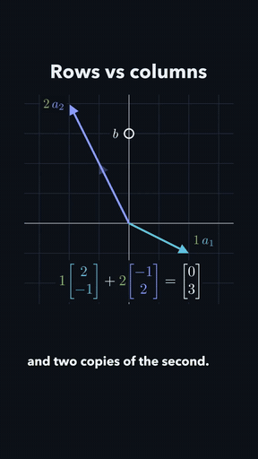
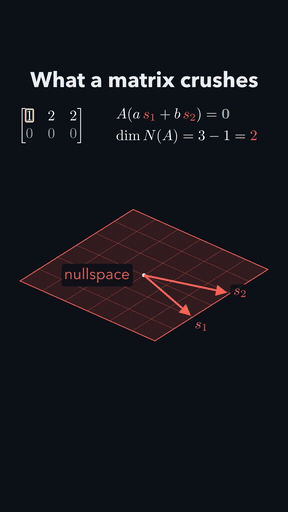
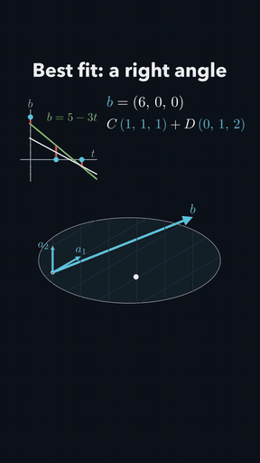
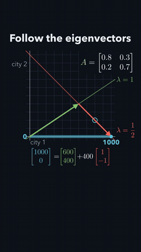
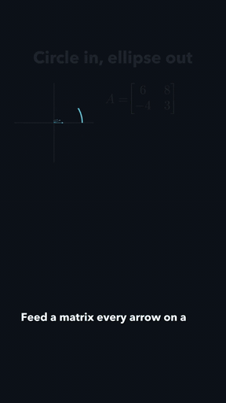
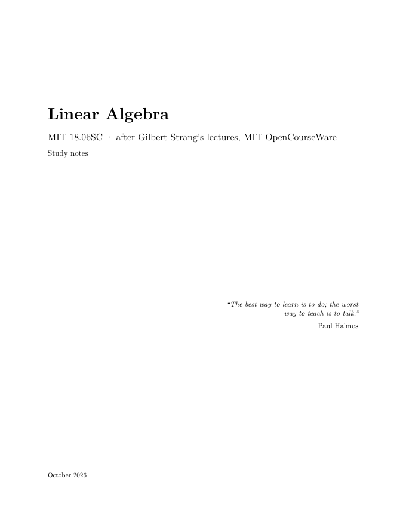
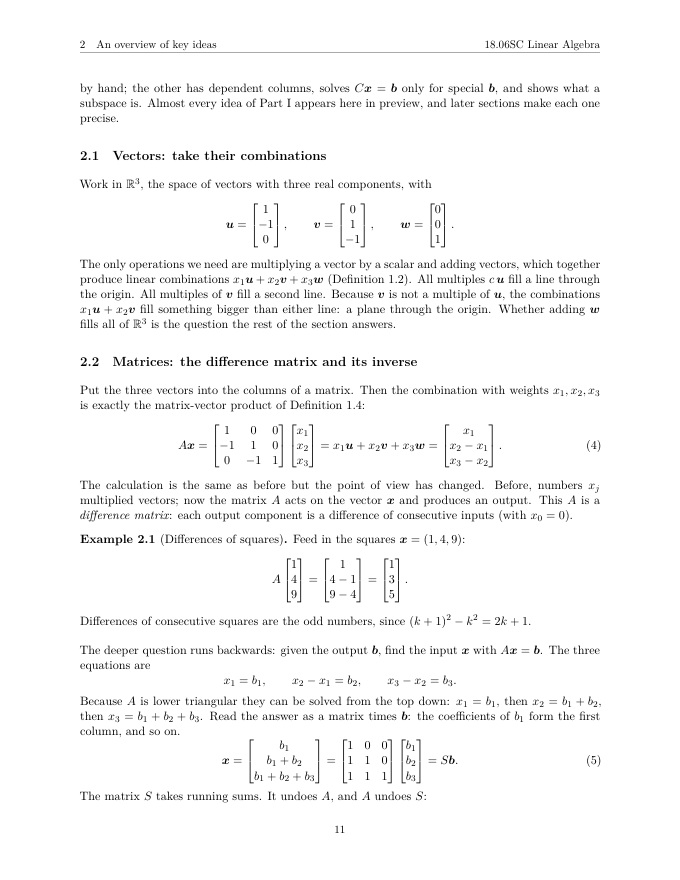
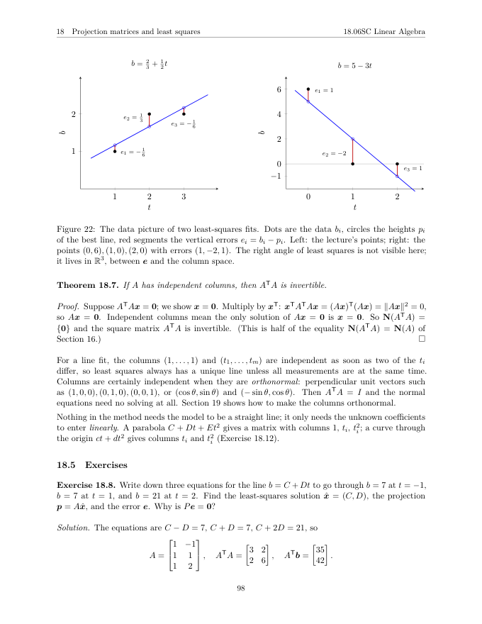
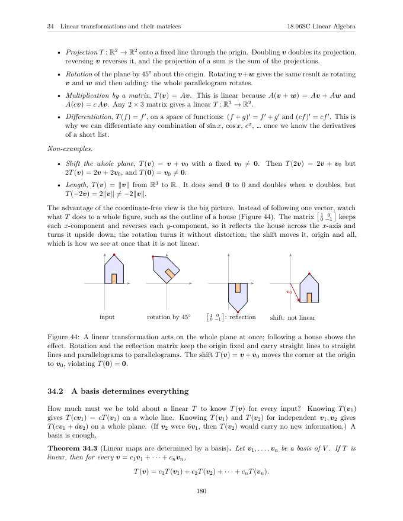

# Course → Shorts

**Paste a course link. Get complete study notes and a series of narrated, 3Blue1Brown-style explainer shorts.**

[](https://github.com/arav31/CourseToShortsSkills/actions/workflows/tests.yml)


<table>
<tr>
<td align="center" width="20%"><a href="docs/media/01-rows-columns.mp4"></a><br><sub><b>Two pictures of one system</b></sub></td>
<td align="center" width="20%"><a href="docs/media/02-four-subspaces.mp4"></a><br><sub><b>What a matrix crushes</b></sub></td>
<td align="center" width="20%"><a href="docs/media/03-least-squares.mp4"></a><br><sub><b>Best fit: a right angle</b></sub></td>
<td align="center" width="20%"><a href="docs/media/04-eigenvectors.mp4"></a><br><sub><b>Follow the eigenvectors</b></sub></td>
<td align="center" width="20%"><a href="docs/media/05-svd.mp4"></a><br><sub><b>Circle in, ellipse out</b></sub></td>
</tr>
</table>

<p align="center"><sub>Five narrated shorts made from <a href="https://ocw.mit.edu/courses/18-06sc-linear-algebra-fall-2011/">MIT 18.06SC Linear Algebra</a> by agents using these skills. Click a preview for the full video with sound (60–80 s each).</sub></p>

<table>
<tr>
<td width="25%"><a href="docs/media/linear-algebra-notes.pdf"></a></td>
<td width="25%"><a href="docs/media/linear-algebra-notes.pdf"></a></td>
<td width="25%"><a href="docs/media/linear-algebra-notes.pdf"></a></td>
<td width="25%"><a href="docs/media/linear-algebra-notes.pdf"></a></td>
</tr>
</table>

<p align="center"><sub>…and <a href="docs/media/linear-algebra-notes.pdf">221 pages of notes</a> for the same course: 41 sections, 155 theorems with proofs, 152 worked examples, 76 figures, 172 solved exercises. Sources, plan and scenes are in <a href="examples/">examples/</a>.</sub></p>

A set of five [Agent Skills](https://agentskills.io) for Claude Code and Codex. Point your agent at a
course (MIT OpenCourseWare or any course site, a syllabus, lecture PDFs, a folder of notes) and it:

1. **reads the whole course** into plain-text sources and writes its outline,
2. **plans a beginner-safe series of shorts**, each built around a concrete, verified worked example,
3. **writes the full course notes in LaTeX**: definitions, theorems with proofs, worked examples, TikZ figures, exercises with solutions, and compiles them to PDF,
4. **storyboards, codes, narrates and renders each short** as a vertical Manim video with synced voiceover and burned-in captions, then **looks at the frames** and fixes what it sees,
5. **packages the series for Instagram Reels** and (only when you ask) publishes it.

## Install

**Claude Code**

```text
/plugin marketplace add arav31/CourseToShortsSkills
/plugin install course-to-shorts@course-to-shorts
```

**Codex**

```bash
codex plugin marketplace add arav31/CourseToShortsSkills
codex plugin add course-to-shorts@course-to-shorts
```

**Any agent that reads skill folders** (or to hack on the skills):

```bash
git clone https://github.com/arav31/CourseToShortsSkills.git
cd CourseToShortsSkills && ./install.sh          # links skills into ~/.claude/skills and ~/.codex/skills
```

Then let the agent set up the Python side (it runs `doctor.py`, which creates
`~/.course-shorts/venv` with Manim, PyMuPDF and edge-tts). System tools it checks for:
**FFmpeg** (with libass), a **TeX engine** ([tectonic](https://tectonic-typesetting.github.io) is the
easiest: `brew install tectonic`), and **cairo/pango** for Manim (`brew install cairo pango pkg-config`).

## Use

Just ask:

```text
Turn https://ocw.mit.edu/courses/18-06sc-linear-algebra-fall-2011/ into study notes and five explainer shorts.
Make a narrated short showing why eigenvectors keep their direction.
Write complete notes for the course in runs/mit-6006, then render the first three shorts.
Where does runs/mit-18-06sc stand? Is it ready to post?
```

Everything for a course lands in `runs/<course>/`: `sources/`, `outline.json`, `short_plan.json`,
`notes/notes.pdf`, `shorts/NN-<slug>/NN-<slug>.mp4`, and `reels_queue.json`.

## The skills

| skill | what the agent does | what the scripts do |
|---|---|---|
| [`course-to-shorts`](skills/course-to-shorts/SKILL.md) | runs the whole pipeline, keeps you in the loop, fans out work to subagents | `doctor.py` (environment), `run_status.py` (status + publish gate) |
| [`course-plan`](skills/course-plan/SKILL.md) | reads the course, writes the outline and the shorts plan with verified examples | `ingest.py` (crawl + PDF/HTML/transcript extraction, boilerplate removal), `check_plan.py` |
| [`course-notes`](skills/course-notes/SKILL.md) | writes every unit as real LaTeX notes and reviews the rendered pages | `build_notes.py` (compile, lint, page previews, parallel unit builds) |
| [`course-video`](skills/course-video/SKILL.md) | storyboards, writes the Manim scene, reviews contact sheets, iterates, approves | `shortkit.py` (9:16 toolkit), `voice.py`, `render.py`, `audit.py` |
| [`course-reels`](skills/course-reels/SKILL.md) | writes captions, builds the posting queue, publishes on request | `reels.py` (queue + Instagram Graph API) |

## How it works

```
 course URL / PDFs / folder
          │
   course-plan ── ingest.py ──▶ sources/*.txt ──▶ outline.json ──▶ short_plan.json ──▶ check_plan.py
          │
          ├────────────── course-notes ──▶ notes/units/uNN.tex ──▶ build_notes.py ──▶ notes.pdf ──▶ look at pages
          │
          └── course-video (per short) ──▶ storyboard.md ──▶ scene.py (shortkit)
                                               │
                     voice.py: narration per beat (edge-tts / Piper / say / OpenAI)
                     render.py: Manim ▶ beat-synced audio mix ▶ captions ▶ H.264 ▶ automatic checks
                     audit.py: contact sheets + frames ──▶ agent looks, fixes, re-renders ──▶ approve
          │
   course-to-shorts: run_status.py --gate ──▶ course-reels: reels.py queue / publish
```

The split is deliberate. **The agent does the teaching**: choosing the ideas, finding a worked
example that exercises the actual mechanism, writing the proofs, designing the animation, and
judging the result by looking at it. **Scripts do everything mechanical and checkable**:
crawling, LaTeX compilation, rendering, audio sync, caption timing, frame sampling, and
hash-bound approvals, so nothing is called done unless someone saw that exact file.

### What `shortkit` gives every scene

- **9:16 zones** (`TITLE_ZONE`, `STAGE`, `CAPTION_ZONE`) that keep content clear of the Reels UI and the captions.
- **Real LaTeX in video** via tectonic → PDF → SVG, so no full TeX install is needed; colour macros (`\cB{}`, `\cG{}`, …) for semantic colouring.
- **Narration-timed beats**: `with self.beat("id"):` lasts as long as that line's voiceover, so picture and voice stay in sync and captions use real word timings.
- **A layout checker** that runs on the live scene after every beat: overlapping text, text outside the safe area or in the caption band, unreadably small text, and text that hides or is crossed by arrows and curves.
- **Helpers for common visuals**: `stage_plane`, `vec`, `matrix_grid` (addressable rows/columns), `live_text` counters, `ortho` 3D projection, `clipped_line`, `axis_numbers`, `swap`, `cue("word")` to land motion on a spoken word, and `spoken(89)` to assert that narration matches computed numbers.

### Quality gates

| gate | checks |
|---|---|
| `check_plan.py` | required fields, concrete and non-placeholder examples, no reused examples, prerequisites point backwards, every unit covered or skipped with a reason |
| `build_notes.py` | real TeX compile; no placeholders, code-style maths, unsolved exercises, units without worked examples, boilerplate repetition, undefined refs, missing glyphs, near-empty pages |
| `render.py` | layout errors from the scene, narration gaps, static stretches, blank frames, resolution/codec, missing audio |
| `audit.py approve` | a human or agent looked at the contact sheets; the approval is bound to the MP4's SHA-256 |
| `run_status.py --gate` | everything above is present **and current**: stale plans, notes, renders or approvals count as missing |

## Why v2 replaced the generator

Version 1 ([`v1-deterministic-engine`](https://github.com/arav31/CourseToShortsSkills/tree/v1-deterministic-engine))
tried to produce every plan, note and animation from hand-written Python: ~80,000 lines,
including a 48,000-line generator with per-domain renderers, plus 90 test files. Each new
course exposed another failure mode, which [its own audit](docs/history/v1-quality-audit.md)
logs in detail (generic openers, decorative motion, templated notes, formulas copied
across topics). On its own quick-start sample, the notes contract failed and both preview
videos crashed.

Current models can do the creative part directly and check their own work by looking at
rendered frames and pages. So v2 keeps the hard-won quality rules from that audit as the
skills' rubric ([video](skills/course-video/references/quality-bar.md),
[notes](skills/course-notes/references/notes-style.md)) and keeps the code small (about 4,100
lines across twelve scripts) and focused on what code is good at: extraction, compilation, rendering, sync,
measurement and gating.

## How the skills were tested

The skills were tested the way they will be used: fresh agents received only a skill folder
and a one-line request, with no extra coaching, and reported every point of friction.

- **1 planner** crawled MIT 18.06SC (247 sources), wrote the 41-unit outline and the 5-short plan.
- **6 notes writers** wrote the 41 units in parallel (about 7 each) with parallel-safe unit builds.
- **5 video makers** each storyboarded, coded, narrated, rendered, reviewed and approved one short.
- **1 standalone test** made the Bayes short from a single sentence, with no course behind it.

Their reports found real bugs that were fixed while they worked, for example: fraction bars that
rendered invisibly, narration drifting from the picture on cached re-renders, a deep-copy blow-up
that made `TransformMatchingShapes` hang, a notes preamble that broke PDF bookmarks, a crawler that
missed the course's own lecture order, and checks that were laxer than their documentation. Each fix
landed in the scripts, the tests or the skill text, so the next run starts from it.

## Development

```bash
python3 -m venv .venv && .venv/bin/pip install -r requirements.txt pytest
.venv/bin/python -m pytest -q          # unit tests + an end-to-end render when manim/ffmpeg/TeX are present
```

CI runs the unit tests and a full render job (Manim + TeX Live + FFmpeg) on every push.
The skills follow the open Agent Skills format, so they also work in other agents that load
`SKILL.md` folders; the plugin manifests cover Claude Code (`.claude-plugin/`) and Codex
(`.codex-plugin/`, `.agents/plugins/`).
Contributions that make the skills teach better are welcome: sharper rubric items,
toolkit helpers for common visuals, better extraction for course sites, more voice engines,
and publishing adapters for other platforms.

## Licence of the examples

The example notes, videos and scenes in `examples/` and `docs/media/` are derived from MIT
OpenCourseWare 18.06SC (Gilbert Strang) and shared under
[CC BY-NC-SA 4.0](https://creativecommons.org/licenses/by-nc-sa/4.0/). MIT OpenCourseWare does not endorse them.
